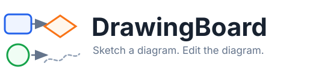
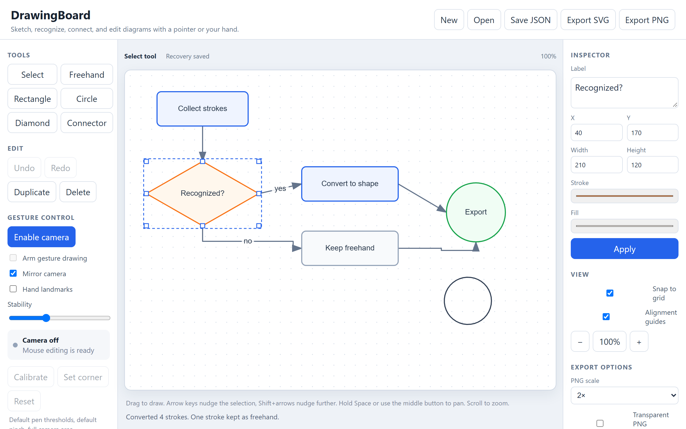

# DrawingBoard

**Turn rough sketches into editable diagrams, using a mouse or experimental hand gestures.**

A browser-based diagram editor built with vanilla JavaScript, SVG and Canvas. Draw shapes and connectors, refine a freehand sketch, and export the result without an account or build step.

[](https://github.com/Coins99/DrawingBoard/actions/workflows/test.yml)

[Quick start](#quick-start) · [Two-minute tour](#two-minute-tour) · [Architecture](docs/architecture.md) · [Recognition evaluation](docs/recognition-evaluation.md)



## Highlights

- **Editable diagrams:** rectangles, circles, diamonds, freehand strokes and connectors with labels.
- **Sketch recognition:** ranked shape suggestions for supported freehand strokes.
- **Precise editing:** resize, duplicate, nudge, snap to grid, use alignment guides and undo/redo changes.
- **Portable files:** save and reopen validated JSON; export SVG or PNG at 1× or 2×.
- **Optional camera input:** explicit camera activation, calibration and a gesture state machine.
- **Local recovery:** IndexedDB autosave with a localStorage fallback.

Mouse editing has automated browser coverage. Gesture input is tested with replayed landmarks; real-camera acceptance remains open.

## Quick start

You need **Node.js 20.11 or newer**.

```sh
git clone https://github.com/Coins99/DrawingBoard.git
cd DrawingBoard
npm start
```

No npm installation is needed to run the editor. The server opens the browser and prints its URL; the default port is **4173**. If that port is busy, it tries the next few.

| Option | Command |
| --- | --- |
| Windows setup helper | `.\setup.cmd` |
| macOS / Linux setup helper | `./setup.sh` |
| Choose a port | `npm start -- --port 4174` |
| Keep browser opening manual | `npm start -- --no-open` |
| PowerShell blocks npm | Use `npm.cmd` in place of `npm` |

The setup helpers check for Node.js and offer installation if it is missing. Add `--dev` to a helper to install test dependencies.

For mouse editing without a local server, open `DrawingBoard/index.html` from disk. Camera input requires localhost or HTTPS and browser permission. MediaPipe model assets load from a CDN; mouse editing remains usable when the model is unavailable.

## Two-minute tour

1. Choose **Rectangle** (`R`) and drag to create a node. Add a second node with **Circle** (`O`) or **Diamond** (`D`).
2. Choose **Connector** (`C`) and connect the nodes.
3. Switch to **Select** (`V`), move a shape and try resizing it. Toggle grid snapping or alignment guides.
4. Choose **Freehand** (`P`) to sketch a supported shape and review the recognition suggestion.
5. Try undo/redo, then save JSON to keep an editable copy. Export SVG or PNG for sharing.

| Action | Shortcut |
| --- | --- |
| Select / Freehand | `V` / `P` |
| Rectangle / Circle / Diamond / Connector | `R` / `O` / `D` / `C` |
| Undo / Redo | `Ctrl/Cmd+Z` / `Ctrl/Cmd+Shift+Z` |
| Duplicate / Delete | `Ctrl/Cmd+D` / `Delete` |
| Nudge / Larger nudge | Arrow keys / `Shift` + arrow keys |
| Pan / Zoom | Hold `Space` or middle button / scroll |

### Try gesture input

Enable the camera, run **Calibrate**, and use **Set corner** to define two opposite corners of your reachable area. Arm gesture drawing: touch thumb to pinky to ready the pen, move the index fingertip to draw, then touch again to lift. In Select, dwell highlights an object and a pinch drags it.

Disabling the camera releases the device. Calibration and stability settings help tune input, but hardware behavior is still unverified. See [the manual camera checklist](docs/manual-camera-checklist.md) to evaluate your setup.

## Engineering

Accepted objects render as **SVG** so they remain selectable and exportable. Draft strokes and the hand cursor use a **Canvas** overlay. Pointer and gesture input share the same editing lifecycle and command layer.

The versioned document model validates mutations and imports before committing them. Invalid imports leave the current diagram intact; labels render as text. The test suite covers geometry, document history, recognition, gesture timing, persistence and editor behavior.

| Path | Responsibility |
| --- | --- |
| `DrawingBoard/app.js` | Compose the editor and input workflows |
| `DrawingBoard/src/document.js`, `commands.js` | Document model, validation and transactions |
| `DrawingBoard/src/geometry.js`, `render.js` | Geometry, hit testing, routing and SVG |
| `DrawingBoard/src/recognition.js`, `arrow.js` | Shape candidates and two-stroke arrows |
| `DrawingBoard/src/gestures.js`, `camera.js` | Gesture state and camera lifecycle |
| `tests/unit/`, `tests/e2e/` | Unit checks and browser regression scenarios |

Read [the architecture guide](docs/architecture.md) for module details and the JSON format.

## Development and verification

```sh
npm ci
npx playwright install chromium
npm test
npm run test:e2e
npm run evaluate
```

Development dependencies are needed for browser tests and screenshot generation. Unit tests and the synthetic recognition evaluation use Node's built-in APIs.

Browser tests replay landmark fixtures and block the MediaPipe CDN. They check behavior when the hand model is unavailable and make gesture sequences repeatable. These checks do not measure real-hand accuracy or camera performance.

For visual changes, regenerate the demo with `node scripts/screenshot.mjs`. See [the contributor guide](CONTRIBUTING.md) for pull request and bug report guidance.

## Status and limits

- Real-camera frame rate, latency and false-activation measurements remain unperformed.
- Recognition evaluation uses synthetic fixtures from zero participants. It is a regression baseline; see [the evaluation method and results](docs/recognition-evaluation.md).
- Recognition supports circles, rectangles, diamonds and one arrow vocabulary. Other shapes remain freehand; near-45° rectangles may be offered as diamonds.
- Connector waypoints cannot be edited manually, and orthogonal routing does not avoid obstacles.
- Gesture selection works on one object at a time; labels use typed input.
- Autosave is scoped to the browser and origin. Use **Save JSON** for a portable backup.
- PNG export is limited to 16 million pixels and 8,192 pixels per side; larger diagrams export at a reduced scale.

## Acknowledgements

Developed by [Junran Zhou (Coins99)](https://github.com/Coins99).

- [MediaPipe Hands](https://github.com/google-ai-edge/mediapipe) provides the pinned hand landmark model.
- [Playwright](https://playwright.dev) supports browser tests and landmark replay.
- The earlier README drew on [stronghold](https://github.com/alichtman/stronghold) by Aaron Lichtman.
